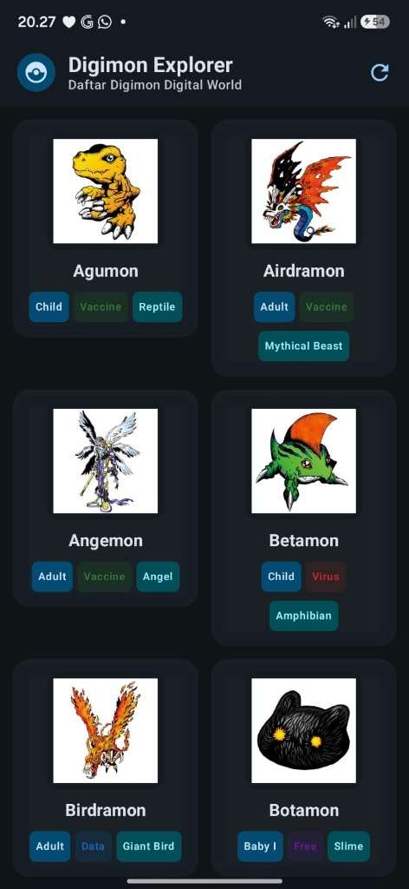
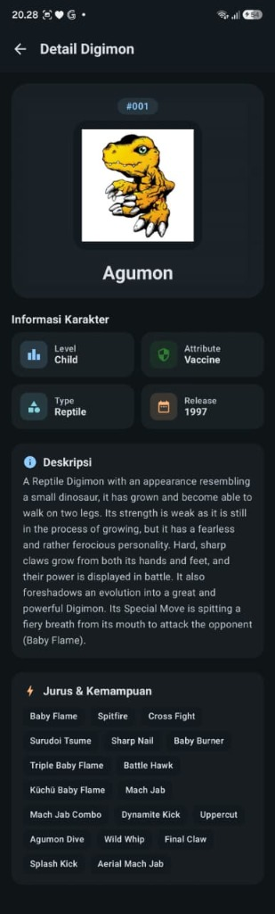

# 📱 Digimon Explorer - Responsi Praktikum Pemrograman Mobile

Aplikasi Android modern untuk menjelajahi dan mengidentifikasi Digimon di Dunia Digital, dibangun menggunakan **100% Jetpack Compose (NO XML Layout)**, arsitektur murni **MVVM (Model-View-ViewModel + Repository)**, serta **Material Design 3**.

---

## 👤 Informasi Mahasiswa
* **Nama** : Nayli Ghassaniy
* **NIM** : H1D024058
* **Shift** : D
* **Mata Kuliah** : Praktikum Pemrograman Mobile
* **Repository GitHub** : [https://github.com/naylighassaniy/H1D024058_Responsi_Digimon-D-_Nayli-Ghassaniy](https://github.com/naylighassaniy/H1D024058_Responsi_Digimon-D-_Nayli-Ghassaniy)

---

## 📸 Tangkapan Layar Aplikasi (Screenshots)

| 🏠 Home Screen (Grid & Attribute Badge) | 🔍 Digimon Detail Screen |
| :---: | :---: |
|  |  |

---

## 📋 Daftar Isi
1. [Deskripsi Proyek](#-deskripsi-proyek)
2. [Fitur Utama](#-fitur-utama)
3. [Kesesuaian Persyaratan Teknis](#-kesesuaian-persyaratan-teknis)
4. [Tech Stack & Pustaka](#-tech-stack--pustaka)
5. [Arsitektur Proyek (MVVM)](#-arsitektur-proyek-mvvm)
6. [Struktur Folder](#-struktur-folder)
7. [Implementasi 2 Layar & Navigasi](#-implementasi-2-layar--navigasi)
8. [Penanganan State (UI State)](#-penanganan-state-ui-state)
9. [Cara Menjalankan Proyek](#-cara-menjalankan-proyek)

---

## 📖 Deskripsi Proyek
Dunia digital sedang dilanda kekacauan akibat ulah seorang tamer jahat yang mengendalikan Digimon sesuka hatinya. Aplikasi **Digimon Explorer** dibuat untuk membantu para tamer mengidentifikasi Digimon lawan dengan menyajikan informasi mendalam mengenai nama, level, atribut, tipe, tanggal debut, deskripsi ensiklopedia, hingga daftar jurus (*skills*) yang bersumber langsung dari **Digi-API (DAPI)** publik secara *real-time*.

---

## ✨ Fitur Utama
* **100% Jetpack Compose & Material 3**: UI deklaratif murni tanpa satu pun layout XML.
* **Integrasi Digi-API (DAPI)**: Mengambil data real-time dari endpoint RESTful `https://digi-api.com/api/v1/`.
* **Home Screen**:
  * Menampilkan kumpulan Digimon menggunakan `LazyVerticalGrid` 2 kolom yang responsif.
  * Setiap kartu memuat: **Nama Digimon**, **Level**, **Attribute** (dengan badge warna dinamis sesuai jenis), **Type**, dan **Avatar Gambar** karakter.
  * Manajemen UI State lengkap: **Loading Indicator**, **Error State (dengan tombol Coba Lagi/Retry)**, dan **Data Content**.
* **Detail Screen**:
  * Menampilkan informasi komprehensif: Avatar gambar resolusi tinggi, Badge Level, Attribute, Tipe, Tahun Rilis (*Release Date*), Deskripsi ensiklopedia, dan daftar Jurus/Kemampuan (*Skills*).
  * Dilengkapi tombol navigasi kembali (*Back*) ke Home Screen pada TopAppBar.
* **Optimasi Performa**:
  * Pengambilan data detail paralel menggunakan Kotlin Coroutines (`async/awaitAll`).
  * In-memory caching di layer repository untuk navigasi instan tanpa overhead network berulang.
* **Custom Theme & Typography**: Skema warna cyber-digital kontras Material 3 dan tipografi custom.

---

## ✅ Kesesuaian Persyaratan Teknis

| No | Persyaratan Soal | Status | Implementasi |
|:---|:---|:---:|:---|
| 1 | Bahasa Kotlin (Data class, Null safety, Lambda, Collection) | ✅ Terpenuhi | Menggunakan data class DTO, null-safe operators (`?.`, `?:`), lambdas pada Composable, dan List collection operations |
| 2 | UI Jetpack Compose & Material 3 | ✅ Terpenuhi | 100% Composable dengan Scaffold, Card, Button, TopAppBar M3 |
| 3 | Custom Theme & Typography | ✅ Terpenuhi | `ui/theme/Theme.kt`, `Color.kt`, dan `Type.kt` |
| 4 | List menggunakan LazyColumn / LazyVerticalGrid | ✅ Terpenuhi | `LazyVerticalGrid(columns = GridCells.Fixed(2))` di `HomeScreen.kt` |
| 5 | Networking: Digi-API (DAPI) | ✅ Terpenuhi | Retrofit 2 + Gson Converter mengonsumsi `https://digi-api.com/api/v1/` |
| 6 | Data Minimal: Nama, Level, Attribute, Type | ✅ Terpenuhi | Ditampilkan lengkap di kartu beranda dan halaman detail |
| 7 | Gambar Digimon | ✅ Terpenuhi | Ditampilkan menggunakan Coil Compose (`AsyncImage`) dengan crossfade |
| 8 | Arsitektur MVVM (Model, View, ViewModel, Repository) | ✅ Terpenuhi | Terbagi rapi di package `data/model`, `data/repository`, `ui/screens`, `ui/theme` |
| 9 | Maksimal 2 Screens & Navigation | ✅ Terpenuhi | Home Screen & Detail Screen dikelola oleh Jetpack Compose Navigation |
| 10 | State UI (Minimal Data, Loading, Error) | ✅ Terpenuhi | Sealed interface UI State dengan penanganan kondisi Loading, Success, dan Error |
| 11 | Tidak menggunakan XML Layout | ✅ Terpenuhi | Tanpa XML layout |
| 12 | Tidak perlu database & auth | ✅ Terpenuhi | Menggunakan in-memory caching di repository tanpa database eksternal |

---

## 🛠 Tech Stack & Pustaka
* **Bahasa**: Kotlin 2.0.0 (Data Classes, Null Safety, Coroutines, Flow, Lambdas, Collections).
* **UI Toolkit**: Jetpack Compose (BOM 2024.04.01) + Material Design 3.
* **Arsitektur**: MVVM (Model - View - ViewModel) + Repository Pattern.
* **Networking**:
  * Retrofit 2.11.0 + Gson Converter
  * OkHttp 4.12.0 + Logging Interceptor
* **Image Loading**: Coil Compose 2.7.0 (Asynchronous Image Loader dengan smooth crossfade).
* **Navigasi**: Jetpack Compose Navigation 2.8.5.

---

## 🏛 Arsitektur Proyek (MVVM)

```
       ┌────────────────┐
       │   Digi-API     │
       └───────▲────────┘
               │ HTTP / JSON
       ┌───────▼────────┐
       │ DigiApiService │ (Retrofit Client)
       └───────▲────────┘
               │ DTO & Domain Model
       ┌───────▼──────────────┐
       │ DigimonRepository    │ (Data Layer & In-Memory Cache)
       └───────▲──────────────┘
               │ Coroutine StateFlow
       ┌───────▼──────────────┐
       │ Home/Detail ViewModel│ (State Holder & Business Logic)
       └───────▲──────────────┘
               │ Observe State (Loading / Success / Error)
       ┌───────▼──────────────┐
       │ Jetpack Compose View │ (Home & Detail Screen UI)
       └──────────────────────┘
```

1. **Model (`data/model/`)**:
   * DTO (*Data Transfer Object*) untuk deserialisasi respons JSON dari Digi-API.
   * Domain Model `Digimon` yang bersih dan siap dikonsumsi UI Layer.
2. **Repository (`data/repository/`)**:
   * Abstraksi sumber data melalui `DigimonRepository`.
   * Melakukan fetching data list sekaligus melengkapi Level, Attribute, dan Type secara concurrent dengan Coroutines.
3. **ViewModel (`ui/screens/**/`)**:
   * Mengelola lifecycle dan mengekspos `StateFlow<UiState>` ke Composable.
4. **View (`ui/screens/**/`)**:
   * Fungsi Composable deklaratif yang bereaksi langsung terhadap perubahan state.

---

## 📁 Struktur Folder

```text
com.responsi.digimonexplorer/
│
├── MainActivity.kt                       # Entry point aplikasi (Edge-to-edge & Theme host)
│
├── data/
│   ├── api/
│   │   ├── ApiClient.kt                 # Inisialisasi Retrofit & OkHttpClient singleton
│   │   └── DigiApiService.kt            # Definisi endpoint RESTful Digi-API
│   ├── model/
│   │   └── DigimonModels.kt             # DTO JSON & Domain Model Digimon + Mapper
│   └── repository/
│       └── DigimonRepository.kt         # Interface & Implementasi Repository
│
└── ui/
    ├── navigation/
    │   ├── Screen.kt                    # Sealed class rute navigasi (Home & Detail)
    │   └── NavGraph.kt                  # NavHost konfigurasi alur 2 layar
    ├── screens/
    │   ├── home/
    │   │   ├── HomeUiState.kt           # Sealed interface state (Loading, Success, Error)
    │   │   ├── HomeViewModel.kt         # ViewModel beranda & pemanggil repository
    │   │   └── HomeScreen.kt            # Grid Digimon, kartu item, loading & retry
    │   └── detail/
    │       ├── DetailUiState.kt         # Sealed interface state detail
    │       ├── DetailViewModel.kt       # ViewModel detail & logika retry
    │       └── DetailScreen.kt          # Tampilan detail Digimon & tombol back
    └── theme/
        ├── Color.kt                     # Skema warna Material 3 & badge atribut
        ├── Theme.kt                     # Konfigurasi Tema DigimonTheme
        └── Type.kt                      # Konfigurasi tipografi custom
```

---

## 🔄 Penanganan State (UI State)

Aplikasi menerapkan pola **Unidirectional Data Flow (UDF)** dengan 3 kondisi state:

```kotlin
sealed interface HomeUiState {
    object Loading : HomeUiState
    data class Success(val digimons: List<Digimon>) : HomeUiState
    data class Error(val message: String) : HomeUiState
}
```

* **Loading**: Menampilkan `CircularProgressIndicator` saat data sedang diunduh dari jaringan.
* **Success**: Menampilkan `LazyVerticalGrid` dengan daftar kartu Digimon yang interaktif.
* **Error**: Menampilkan ikon peringatan, pesan deskriptif kendala, serta tombol `Coba Lagi` (*Retry*) yang memicu pemuatan ulang data tanpa perlu restart aplikasi.

---

## 🚀 Cara Menjalankan Proyek

1. **Clone Repository**:
   ```bash
   git clone https://github.com/naylighassaniy/H1D024058_Responsi_Digimon-D-_Nayli-Ghassaniy.git
   cd H1D024058_Responsi_Digimon-D-_Nayli-Ghassaniy
   ```

2. **Buka di Android Studio**:
   * Pilih menu **File > Open** lalu arahkan ke direktori proyek ini.
   * Pastikan Gradle Sync berjalan sukses (menggunakan JDK 17 atau 21).

3. **Jalankan Aplikasi**:
   * Hubungkan perangkat Android fisik (via USB debugging) atau jalankan Android Emulator (API 26+).
   * Klik tombol **Run 'app'** (`Shift + F10`).

4. **Membangun APK Debug**:
   ```bash
   ./gradlew assembleDebug
   ```
   File APK hasil build berada di direktori:
   `app/build/outputs/apk/debug/app-debug.apk`

